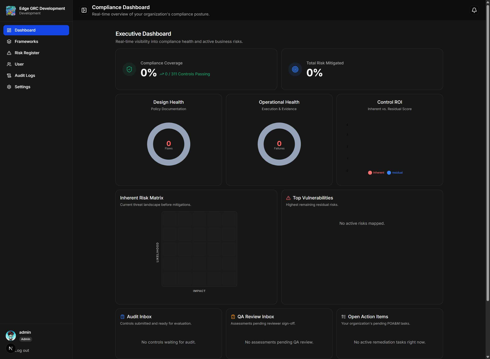
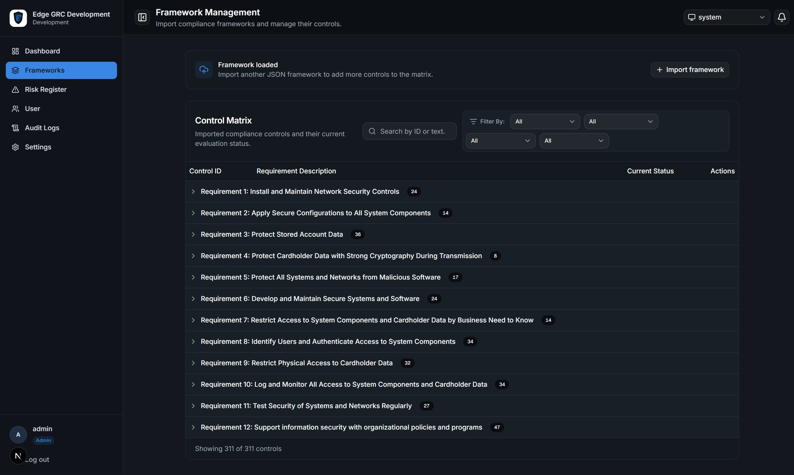
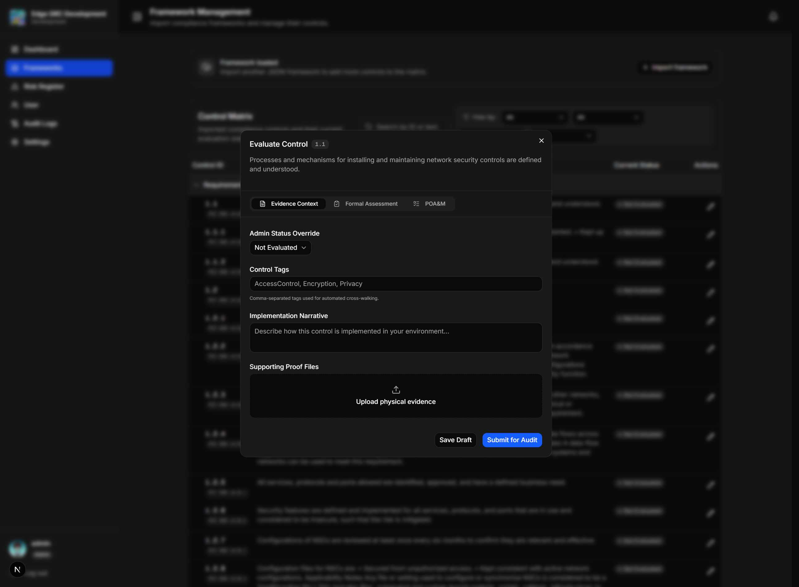
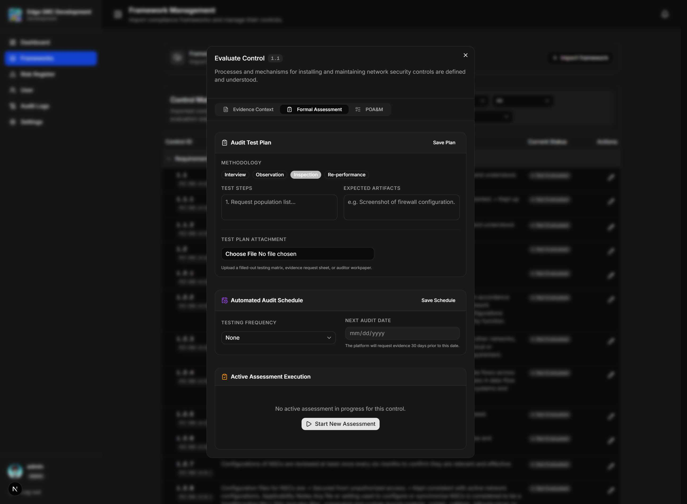
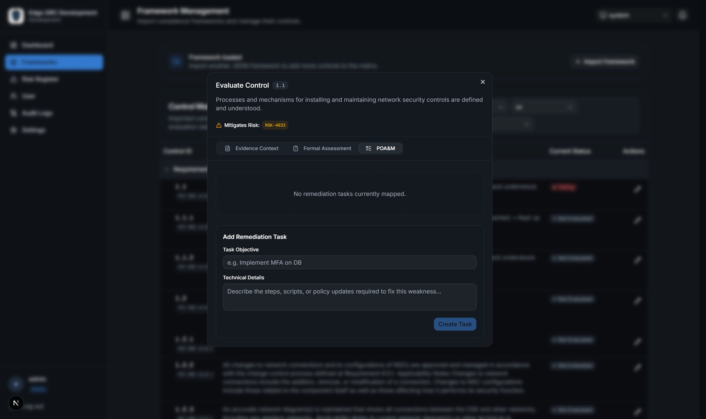
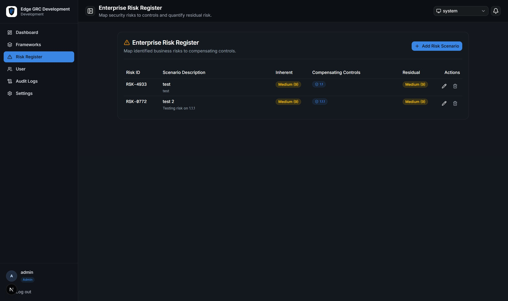
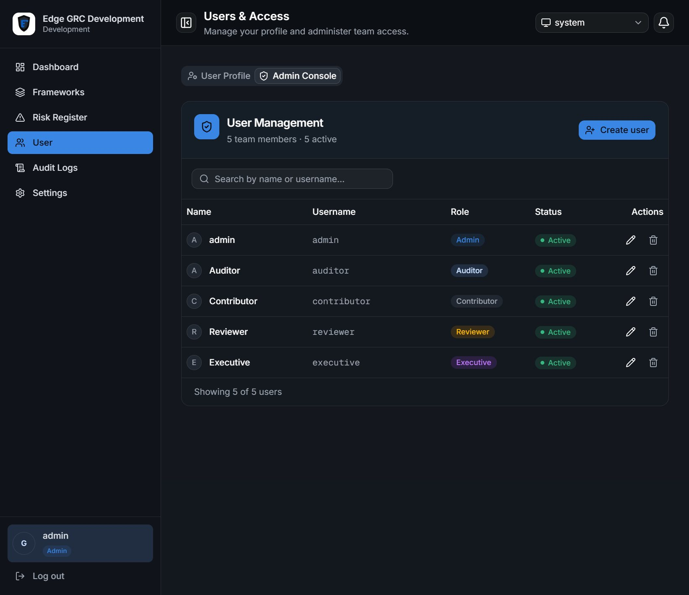
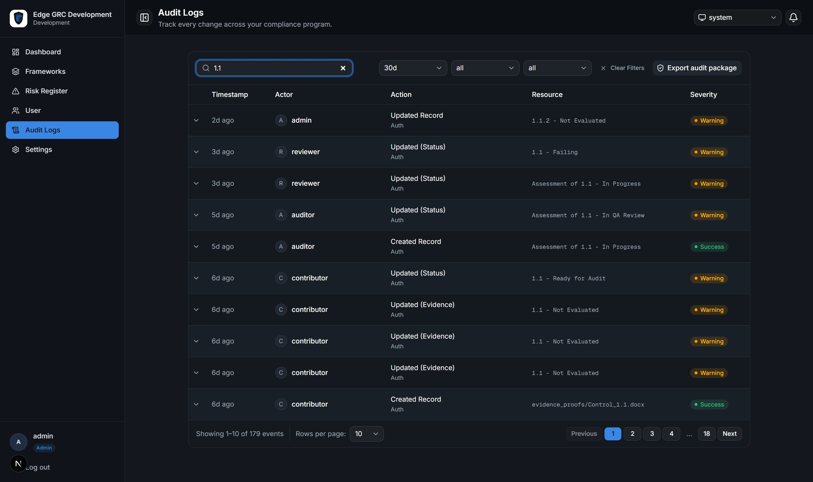
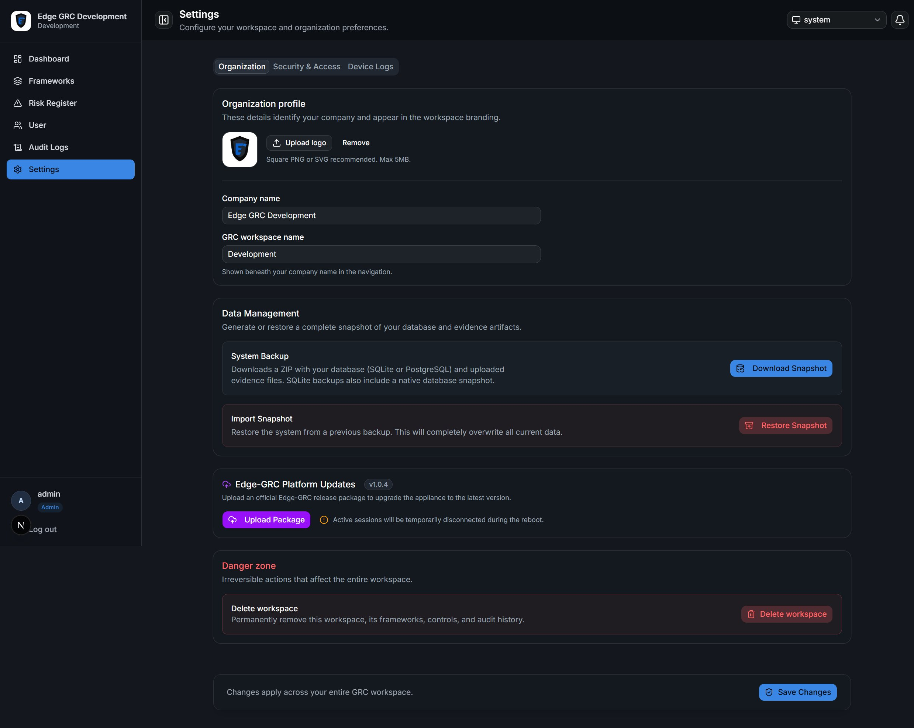

# Edge-GRC Application Guide

This guide explains the Edge-GRC application screens, the information they
manage, the main workflows, and the five account roles. It describes the
application as implemented in this repository; deployment and installation
instructions are in the root [README](../README.md).

The screenshots below show the application in a development workspace using
sample data and an Admin account. Data, branding, and available actions may
differ in another deployment or when signed in with a different role.

## 1. What Edge-GRC does

Edge-GRC is an on-premise governance, risk, and compliance workspace. It
organizes compliance requirements into controls, records how those controls
are implemented, attaches supporting evidence, runs formal assessments,
tracks corrective work, and summarizes risk and compliance status.

The application includes:

- **Framework management:** Import JSON frameworks and manage their controls.
- **Evidence management:** Record implementation narratives, tags, and proof
  files for controls.
- **Assessment management:** Define test plans and schedules, record audit
  activities, and route assessments through quality review.
- **Risk management:** Score risks and link them to mitigating controls.
- **POA&M tracking:** Create and monitor remediation tasks for control gaps.
- **Reporting and traceability:** Review audit events and export audit
  materials.
- **User and appliance administration:** Manage accounts, organization
  branding, sessions, backups, updates, and HTTPS configuration.

The browser interface is a Next.js application. It calls a Django REST API
that stores the controls, relationships, users, and audit records. Supporting
files, such as proof documents and test-plan attachments, are stored by the
backend. The configured database can be SQLite or PostgreSQL; see the root
README for deployment details.

## 2. Sign-in and first-time setup

1. Sign in with the account credentials provisioned for the appliance.
2. On the first sign-in, the account may be required to change its password.
   The login screen also provides password visibility and a remember-me
   option.
3. An administrator who has not completed workspace setup is shown the
   onboarding wizard:
   - **Branding:** Set the legal company name, workspace title, and optional
     logo. The logo is resized before being saved.
   - **Framework:** Import the initial framework as JSON.
   - **Complete:** Finish setup and open the dashboard.
4. Later sign-ins take the user to the main workspace. The default initial
   view is Framework Management.

The organization name, workspace title, and logo appear in the navigation
sidebar. Setup completion is remembered by the browser and can also be
detected from existing workspace data.

## 3. Shared application layout

### Navigation sidebar

The sidebar contains the primary views:

| Navigation item | Purpose |
|---|---|
| **Dashboard** | Summarizes compliance, assessments, risk, and remediation activity. |
| **Frameworks** | Searches and filters the controls matrix and opens individual controls. |
| **Risk Register** | Reviews business risks and their mapped controls. |
| **User** | Opens the signed-in user's profile; administrators also get the Admin Console tab. |
| **Audit Logs** | Searches and filters recorded changes and provides the audit-export entry point. |
| **Settings** | Opens organization, security, and appliance settings available to the role. |

The sidebar's upper area displays the organization logo/name and workspace
title. Its footer displays the signed-in username, role badge, and **Log out**
action. Selecting the profile area opens the User view.

On small screens, navigation opens in a slide-out panel. On desktop, the
sidebar can be collapsed with the panel button in the top bar.

### Top bar and notifications

The top bar shows the selected view's title and short description. The
notification bell opens the signed-in user's notifications. A notification
can be marked read or removed; notifications that point to a control can
navigate directly to that control in Framework Management. Notification
preferences are managed in the user profile.

### Common interface elements

- **Badges** identify states, roles, and related controls. Their color is a
  visual aid; the text label is the actual state.
- **Filters and search fields** narrow the current list without changing the
  underlying records.
- **Expandable rows/groups** reveal more detail while keeping long control
  lists manageable.
- **Dialogs** are used for focused tasks such as editing a control, creating a
  risk, or confirming a consequential action.
- **Toasts** report whether an operation succeeded or failed.
- **Charts and metric cards** summarize stored records. They are indicators,
  not replacements for reviewing the underlying control, assessment, or risk.

## 4. Main screens and what their elements do

### 4.1 Compliance Dashboard

The dashboard combines controls, risks, and tasks into a role-tailored
overview:

- **Compliance score:** Percentage of controls marked Passing, excluding
  controls marked Not Applicable from the denominator.
- **Control counts and status lists:** Show passing, failing, awaiting
  approval, or otherwise outstanding controls. Clicking a status or control
  opens Framework Management with the relevant filter or control selected.
- **Design Health chart:** Distribution of controls rated Effective, Deficient,
  or Not Tested for control design/policy.
- **Operational Health chart:** Distribution of controls rated Effective,
  Deficient, or Not Tested for operation/implementation.
- **Risk summary and charts:** Where shown for the role, compare aggregate
  inherent and residual scores, show risk mitigation, and visualize risk
  levels. Reviewers also see the **Top Vulnerabilities** list; selecting an
  item opens that risk in the Risk Register's edit dialog.
- **Queues and schedules:** Surface work such as controls ready for audit,
  assessments awaiting QA, open remediation tasks, failing controls, and
  scheduled audits. Some lists are paginated.

Dashboard sections are selectively shown by role. A metric may summarize
records a user can view without granting that user permission to change them.

*Dashboard overview. The displayed counts and scores come from the sample
workspace.*

### 4.2 Framework Management and the controls matrix

The Frameworks view contains the framework importer (for administrators) and
the controls table.

#### Importing a framework

The importer accepts a JSON file up to 10 MB. It recognizes common top-level
arrays such as `controls`, `requirements`, `items`, and `policies`, and can
flatten requirements containing sub-requirements. Framework names are taken
from JSON metadata when available, otherwise from the filename. Imported
items are normalized into controls with an identifier, framework name,
description, optional requirement grouping/process text/tags, and an initial
Not Evaluated status.

After a framework is loaded, the importer collapses into a **Framework
loaded** panel. An administrator can reopen it to add another framework. An
import requires recognizable controls in the JSON.

#### Controls table

Controls are grouped by requirement title (or **General Requirements** when
there is no title). The table includes filtering/search tools for:

- Framework
- Control status
- Design effectiveness
- Implementation/operational effectiveness
- Text matching the control identifier, description, requirement, process
  mechanism, or framework

Groups can be expanded or collapsed. Selecting a control opens its detail
dialog. The table also indicates the control's current state and may display
related cross-walked controls, risks, schedules, assessments, and remediation
work.

*Framework Management and the grouped controls matrix.*

#### Control details dialog

The dialog is opened from the controls table or a dashboard/notification
deep-link. Its header shows the control identifier and description, plus
cross-walked control IDs and linked risk IDs when present. It has three tabs:

1. **Evidence Context**
   - **Overall Status:** Shows the control state. Administrators have a
     status override selector.
   - **Control Tags:** Administrators can edit comma-separated tags; tags are
     used in automated cross-walking.
   - **Implementation Narrative:** Describes how the organization implements
     the requirement.
   - **Supporting Proof Files:** Upload, view, or remove attached artifacts,
     subject to role and control-state restrictions.
   - **Save / Ready for Audit:** Saves narrative/evidence changes or
     submits a contributor's work for formal testing. Contributors cannot
     edit after submission while the control is Ready for Audit or awaiting QA
     approval. Only administrators and reviewers can edit the control during
     that period. A QA rejection marks the control Failing and returns it to
     the contributor for corrections.
     The displayed actions depend on the role.
2. **Formal Assessment**
   - **Audit Test Plan:** Select test methodology (Inquiry, Observation,
     Inspection, or Reperformance), define test steps and expected artifacts,
     and attach a workpaper. Administrators and auditors can manage test plans
     before submission; only administrators can edit them while a control is
     submitted for audit.
   - **Audit Schedule:** Set testing cadence (None, Monthly, Quarterly,
     Bi-Annual, Annual) and next audit date.
   - **Assessment activity:** Start an assessment, record design and operating
     effectiveness, and add auditor notes. Auditors can submit an assessment
     for QA; a reviewer or administrator who did not perform the assessment can
     reject or finalize it. Completed assessments are retained as history.
3. **POA&M**
   - Lists corrective tasks for this control, their descriptions, status,
     requester, and creation date.
   - Administrators, auditors, and reviewers can create tasks and update their
     status. Contributors can start or resolve only tasks assigned to them.
     Administrators can delete tasks.

*Evidence Context tab in a control detail dialog.*

*Formal Assessment tab with test-plan and audit-schedule sections.*

*POA&M tab for corrective-action tracking.*

#### Control states and effectiveness ratings

Control status describes overall compliance workflow:

| Status | Meaning in the workflow |
|---|---|
| **Not Evaluated** | No completed evaluation has established a result. |
| **Ready for Audit** | Evidence is ready for an auditor to assess. |
| **Awaiting Approval** | An assessment has been sent for quality review. |
| **Passing** | The completed assessment found no deficient design or operation. |
| **Failing** | The completed assessment found deficient design or operation, or QA returned the control for contributor corrections. |
| **Not Applicable** | The control is excluded from the compliance-score denominator. |

Design effectiveness and implementation effectiveness are separately rated
**Effective**, **Deficient**, or **Not Tested**. A completed assessment sets
the control to Passing unless either rating is Deficient, in which case it
sets the control to Failing. Sending an assessment to QA moves the control to
Awaiting Approval. A QA rejection returns the control to Failing so the
contributor can make corrections. Administrators can also override the status
directly.

### 4.3 Risk Register

The Risk Register records a risk identifier, title, description, inherent
likelihood, inherent impact, and the compliance controls used to mitigate it.
Likelihood and impact use a 1–5 scale. **Inherent score** is likelihood
multiplied by impact; **residual score** is calculated from the mapped
controls' status and effectiveness. Risk-level labels classify scores for
display.

The create/edit dialog lets the user define the scenario and select mitigating
controls and add an optional supporting attachment. Attachments use the
application's secure upload rules, including a 25 MB size limit and supported
document/file-type allowlist; choosing a new attachment replaces the existing
one. Selecting a cross-walked control can select its related controls as a
group. The table compares inherent and residual risk and shows the compensating
controls. Selecting a risk ID from the dashboard or a control's **Mitigates
Risk** links opens that risk in the register's edit dialog for roles permitted
to manage risks.
Executive accounts are presented with a read-oriented view in the interface.

*Risk Register in the sample workspace before risk scenarios have been
entered.*

### 4.4 Users & Access

#### User Profile

The profile screen displays the signed-in user's name and role, supports
avatar upload, and provides password change. Password changes require the
current password, a new password of at least eight characters, and a matching
confirmation.

Notification preferences cover:

- **Assessment Alerts:** Assessment submitted for QA, rejected, or finalized.
- **Task Assignments:** Remediation task assignment or resolution.
- **Audit Schedules:** Upcoming recurring audit reminders.

The profile also describes the role; users cannot assign themselves a new
role through this screen.

#### Admin Console

Administrators have an additional tab for managing accounts. It lists users
and supports searching, creating, editing, activating/deactivating, assigning
a role, and deleting accounts. The interface prevents an administrator from
deleting the currently signed-in account.

*Admin Console with one sample account for each application role.*

### 4.5 Audit Logs

The Audit Logs page presents recorded application changes. It supports:

- Search across actor, action, and resource.
- Date-range, category, and severity filters.
- Expandable event details and pagination.
- Clearing filters to return to the default view.
- Opening the third-party audit exporter.

Create, update, and delete events are visually distinguished. The audit
exporter can produce audit material in PDF or ZIP form, including selected
scope such as summary, records, and evidence; PDF creation runs as a
background job. Audit log access and export are restricted by role at the API
level.

*Audit Logs list and its filtering/export controls.*

### 4.6 Settings

The Settings screen includes **Organization**, **Security & Access**, and
**Device Logs** tabs for administrators. Other roles see only **Security &
Access**.

#### Organization

Administrators can configure company and workspace names and the organization
logo. This identity is reflected in the sidebar and branding surfaces.
Administrator-only appliance actions include:

- **System backup:** Generate a downloadable archive containing database and
  media data.
- **Restore:** Upload a backup and confirm before restoring it.
- **Platform update:** Upload an official update package. The backend checks
  the package signature before applying it; the appliance restarts services,
  interrupting active sessions.
- **HTTPS & trust:** Enable HTTPS by creating appliance certificates and
  download the public certificate for local trust configuration.
- **Active sessions:** Inspect active devices and revoke a session.
- **Factory reset:** Confirm credentials before deleting workspace data.

These operations affect the appliance or stored data. They should be used
only by authorized administrators and with an appropriate backup/maintenance
plan.

#### Device Logs

Administrators can view and download up to the latest 500 lines of the appliance's
backend operational log and refresh the view while troubleshooting. This log is
separate from **Audit Logs**, which records formal application activity.

#### Security & Access

The session timeout control describes how long an account can be inactive
before its session expires. Administrator-only controls in this tab include
HTTPS management and active-session management.

*Administrator Organization Settings. Appliance and organization actions are
not available to ordinary workspace roles.*

## 5. Roles and effective permissions

The application defines five roles: **Admin**, **Auditor**, **Reviewer**,
**Contributor**, and **Executive**. The table below summarizes the API's
permission checks and the intended day-to-day responsibilities.

| Role | Typical responsibility | Controls and evidence | Assessments and test plans | Risks and POA&M | Administration and visibility |
|---|---|---|---|---|---|
| **Admin** | Own workspace configuration and access administration; oversee the complete compliance program. | Import/create controls; full control management and status override; upload and delete proof; manage tags and evidence. | Full assessment access; manage test plans; finalize QA only for assessments performed by another user; manage assessment history. | Create/update/delete risks and remediation tasks. | Manage users, audit logs and exports, branding, sessions, backup/restore, updates, HTTPS, and factory reset. Broad dashboard visibility. |
| **Auditor** | Conduct independent control testing and document findings. | Read controls and evaluate them; cannot delete controls or change evidence through control edits; cannot upload/delete proof files. | Create assessments and manage an assessment while it is In Progress; manage test plans; submit for QA. | Create/update risks; create/update remediation tasks; cannot delete those records. | Can read audit logs and export audit materials; no appliance-settings administration. Dashboard shows audit and health work. |
| **Reviewer** | Perform quality assurance on audit work and review risk/remediation items. | Read controls; review assessment results; no proof upload/delete. | Cannot create assessments; can reject or finalize an In QA Review assessment performed by another user. Cannot delete assessments or manage test plans. | Create/update risks and remediation tasks; cannot delete them. | No audit-log or appliance-settings access. Dashboard emphasizes QA work. |
| **Contributor** | Supply implementation details and evidence and participate in remediation. | Read controls; update permitted control details and narrative; upload/delete proof on unlocked controls. Controls submitted for audit and controls already Passing are locked for contributor changes until QA rejects the assessment. Cannot set Passing or Not Applicable or change effectiveness ratings. | Read assessments; cannot create or manage assessments or test plans. | Read risks and POA&M tasks; cannot create/delete tasks. Can update the status of tasks assigned to them. | Manage own profile/password/avatar and notification preferences. No user administration, audit logs, or appliance settings. |
| **Executive** | Review program posture and risk information without operational control editing. | Read-oriented control and evidence access; no proof upload/delete. | Read assessments and test plans. | Read-only Risk Register access. | Can read audit logs and export audit materials. Dashboard includes executive risk/health summaries. No appliance-settings administration. |

### Permission details and important caveats

- The API, not a hidden or disabled button, is the final authority. A
  user-facing action can be visible while a server request is still rejected.
- The API enforces these permissions independently of the UI. Administrators
  retain broad access, but cannot approve or reject an assessment they
  performed. Assigned Contributors may change only their POA&M task status.
- Therefore, if an action fails with a permission error, the role's API
  permissions take precedence over what the interface appears to offer.
- All roles can generally read the control, risk, task, assessment, and
  test-plan data where those endpoints are used. Audit-log and appliance
  management endpoints have narrower access.

## 6. End-to-end compliance workflow

1. **Load requirements.** An administrator imports one or more framework
   JSON files. Controls appear grouped and searchable in Framework Management.
2. **Document implementation.** Contributors and administrators add an
   implementation narrative and attach supporting proof. Administrators can
   apply tags used for control cross-walking.
3. **Prepare testing.** An administrator or auditor defines the test plan,
   selects a test methodology, documents steps and expected artifacts, and
   sets the testing cadence/next date.
4. **Submit for audit.** A contributor marks evidence ready for audit. The
   control becomes **Ready for Audit**, and configured auditor/admin users
   can be notified.
5. **Assess the control.** An auditor starts an assessment, records design
   and operating effectiveness, and writes notes. The auditor submits it for
   QA; the assessment becomes **In QA Review** and the control becomes
   **Awaiting Approval**.
6. **Review and finalize.** A reviewer or administrator can approve and
   complete the QA-stage assessment. Completion updates the control to
   Passing or Failing based on the assessment ratings.
7. **Remediate failures.** Authorized users create POA&M tasks to track
   corrective work. When a task is resolved, a Failing control is moved to
   Ready for Audit so it can be tested again.
8. **Monitor and report.** Users review dashboard metrics, risks, schedules,
   notifications, and audit history. Authorized roles export audit material.

## 7. Data relationships and calculations

- A **framework** is represented by the framework name on each control; a
  framework import adds controls rather than creating a separate framework
  record.
- A **control** can have supporting proof files, a test plan, many assessment
  records, remediation tasks, mapped risks, tags, and cross-walked controls.
- A **risk** can be linked to multiple mitigating controls. Inherent score is
  likelihood × impact. Residual score is reduced as mapped controls are
  effective, with a partial contribution for controls awaiting approval.
- An **assessment** records status, assessor, design effectiveness,
  operating effectiveness, notes, and start/completion dates.
- A **remediation task** belongs to a control and may identify an assignee,
  requester, due date, and Open / In Progress / Resolved status.
- A **proof file** is a file attached to a control; test-plan attachments are
  separate from proof files.
- **Audit records** are generated for changes to key business records.

The dashboard's scores and charts are derived from these stored values.
Changing control assessments, risk mappings, or task states can therefore
change the displayed summary.

## 8. Security and session behavior

- The browser authenticates to the backend using a session cookie; cookie
  authenticated requests are subject to CSRF checks. The backend also
  supports token authentication for API clients.
- Sessions expire after the configured period of inactivity. Administrators
  can review and revoke active sessions.
- Proof and test-plan uploads use a file allowlist, size limit, content-type
  checks, and antivirus scanning when the local ClamAV service is available.
- Signed update packages are checked against the appliance's update public
  key before installation.
- Role checks are enforced by backend permission classes and explicit
  administrator checks in sensitive appliance operations.

## 9. Related implementation references

- [Main application shell](../grc-frontend/components/grc-app.tsx)
- [Navigation sidebar](../grc-frontend/components/app-sidebar.tsx)
- [Controls table](../grc-frontend/components/controls-table.tsx)
- [Control detail tabs](../grc-frontend/components/edit-evidence-dialog.tsx)
- [Dashboard](../grc-frontend/components/metrics-dashboard.tsx)
- [Risk Register](../grc-frontend/components/risk-register.tsx)
- [User profile and Admin Console](../grc-frontend/components/user-management.tsx)
- [Workspace settings](../grc-frontend/components/workspace-settings.tsx)
- [Role permission checks](../grc-backend/frameworks/permissions.py)
- [Backend data models](../grc-backend/frameworks/models.py)
- [Backend API routes](../grc-backend/frameworks/urls.py)
